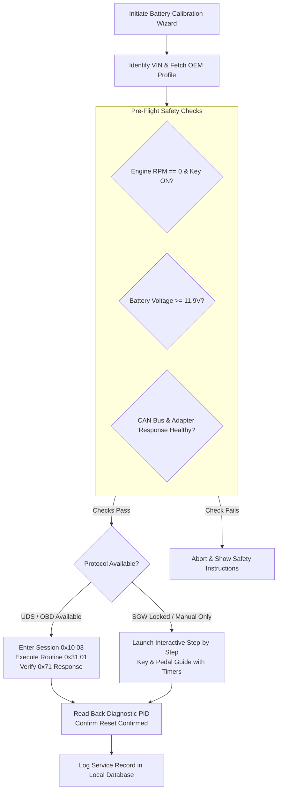

# OBD-Hero: Data Sources & Battery Calibration Protocol Plan

This document establishes the verified data sources, community reverse-engineering repositories, protocol architectures, and OEM-specific methodologies required to implement the universal **Battery Calibration / BMS Reset Engine** and diagnostic knowledgebases in OBD-Hero.

---

## 1. The Core Architecture of Automotive Battery Calibration

In modern vehicles (2010+), smart alternators and Intelligent Battery Sensors (IBS / Hall sensors) actively measure coulomb counting, internal resistance, state-of-charge (SoC), and temperature. The ECU or Body Control Module (BCM) uses historical degradation curves to taper charging voltages over time.

Installing a new battery without resetting these models results in:
- The alternator continuing to pump excessive voltage into a brand new AGM/EFB battery.
- Premature battery failure (often within 12–18 months).
- Ghost electrical DTCs, disabled Auto Start/Stop, and phantom parasitic drain alerts.

### The Two Methodologies in US Consumer Vehicles
1. **Programmatic / OBD-II Diagnostic Routines (UDS / ISO 14229 & KWP2000)**:
   - Entering Extended Diagnostic Session (`0x10 0x03`).
   - Optional Seed/Key Security Access (`0x27`).
   - Triggering Routine Control (`0x31 0x01 [RoutineID]`) or writing new battery parameters via Write Data by Identifier (`0x2E [DID] [Data]`).
2. **Guided Key-Cycle & Pedal Actuator Sequences (OEM Manual Relearns)**:
   - Factory maintenance sequences built into vehicle firmware (e.g., Ford high-beam flash + brake tap sequence; Mazda i-Stop switch cycle).
   - Require zero proprietary security access and have 100% vehicle compatibility when hardware commands are locked behind Secure Gateway (SGW) modules.

---

## 2. Open-Source & Community Data Sources

To construct a universal database of battery reset routines without starting from scratch, OBD-Hero synthesizes data from several active reverse-engineering ecosystems and diagnostic protocol repositories:

### A. Reverse-Engineering & Protocol Codebases
1. **[uholeschak/ediabaslib](https://github.com/uholeschak/ediabaslib) ("Deep OBD")**:
   - **Coverage**: BMW (E, F, G series) & VAG (VW, Audi, Škoda, Seat).
   - **Value**: Contains open-source definitions for EDIABAS job execution over standard ELM327 / Bluetooth. Contains DME/DDE engine management and IBS battery registration jobs (e.g., `steuern_batterietausch_registrieren`).
2. **[dalathegreat/Battery-Emulator](https://github.com/dalathegreat/Battery-Emulator)**:
   - **Coverage**: Modern CAN bus architectures (Nissan, Tesla, Hyundai/Kia, Renault).
   - **Value**: Implements ISO 15765-2 (ISO-TP) multi-frame transport and UDS service layers (`0x31`, `0x2E`, `0x22`) with tested payload framing.
3. **[stuartpittaway/diyBMS](https://github.com/stuartpittaway/diyBMS) & [richClubb/python-uds](https://github.com/richClubb/python-uds)**:
   - **Value**: Standardized ISO 14229 UDS protocol client implementation, session state handling, timing parameters (`P2` and `P2*`), and negative response handling (`0x7F`).
4. **PyRen / DDT4All Database & Extracted Scripts**:
   - **Coverage**: Alliance platforms (Nissan, Mitsubishi, Renault).
   - **Value**: Reverse-engineered XML diagnostic definitions with exact DIDs and routine parameters for body and power management computers.
5. **FORScan Community & As-Built Data Repositories**:
   - **Coverage**: Ford, Lincoln, Mercury, Mazda (pre-2015).
   - **Value**: Complete documentation of BCM diagnostic addresses (`0x726`), battery chemistry configuration registers (`726-04-01`), and the specific UDS Service `0x31 0x01` routine calls.

### B. Public Diagnostic Standards & Repair Knowledgebases
1. **SAE J1979 / ISO 15031-5**: Base standard for OBD-II modes 01 through 0A, standard PIDs, and freeze frame definitions.
2. **SAE J2012 / ISO 15031-6**: Comprehensive Diagnostic Trouble Code classifications (`P`, `C`, `B`, `U`).
3. **NHTSA vPIC Public API & Cache**: Offline SQLite database of US VIN prefixes, enabling immediate identification of Year, Make, Model, Engine Code, and Factory Equipment without requiring internet access.
4. **OEM Factory Service Bulletins & Work Instructions**: Documented factory replacement procedures for battery sensor recalibration.

---

## 3. Manufacturer-by-Manufacturer Breakdown & Implementation Plan

### 1. Ford / Lincoln (Common US Models: F-150, Explorer, Escape, Mustang, Focus, Fusion)
* **Target Module**: Body Control Module (`BCM` / `BdyCM` @ CAN ID `0x726` / Functional `0x7DF`).
* **Method 1 (Programmatic UDS via ELM327)**:
  1. Initialize connection on HS-CAN (or MS-CAN if legacy).
  2. Enter Extended Diagnostic Session: `10 03`.
  3. Send BMS Reset Routine: `31 01 22 40 28` (or model-specific Routine ID).
  4. Verify Positive Response: `71 01 22 40 28`.
  5. Read back Days Since Battery Replacement PID (`0x22 0x40 0x28`) to confirm it reads `0`.
* **Method 2 (Guided Manual Fallback)**:
  1. Key ON, Engine OFF (KOEO).
  2. Flash High Beams 5 times within 10 seconds.
  3. Press and release Brake Pedal 3 times.
  4. Battery warning light on the instrument cluster flashes 3 times to confirm BMS recalibration.
  5. Leave vehicle in sleep mode (locked, undisturbed) for 8 hours for quiescent current calibration.

### 2. General Motors (Chevrolet, GMC, Buick, Cadillac: Silverado, Tahoe, Equinox, Malibu, Sierra)
* **Target Module**: Body Control Module (`BCM` @ CAN ID `0x7E0` / `0x241`).
* **Protocol**:
  - GM uses a Hall-effect Battery Current Sensor on the negative terminal connected to the BCM.
  - BCM runs an internal Battery State of Charge (SoC) integration algorithm.
* **Implementation**:
  - **Diagnostic Command**: UDS Routine Control `31 01` to clear Battery Sensor Learned Parameters or GMLAN adaptation clear.
  - **Natural Sleep Cycle (Documented OEM Fallback)**: GM BCM automatically recalculates battery open-circuit voltage (OCV) and battery capacity after an uninterrupted 4-to-8 hour undisturbed sleep cycle with parasitic draw < 100mA.
  - OBD-Hero will provide both the active BCM routine trigger and the guided GM Sleep Mode instructions.

### 3. Toyota / Lexus (Camry, RAV4, Highlander, Corolla, Tacoma, Tundra)
* **Target Module**: Engine / Hybrid Control Module (`ECM` / `HV ECU` @ CAN ID `0x7E0`).
* **Protocol**:
  - Modern Toyota vehicles feature a Battery Current Sensor on the 12V terminal.
  - Resetting is required if the battery light stays illuminated or start-stop / back-up power fails.
* **Implementation**:
  - OBD2 Service: "Battery Current Sensor Initialization" executed via Toyota Enhanced Diagnostic PID sequence.
  - Initialization confirmation: Verifying voltage curve stabilizes between 13.8V and 14.4V after startup.

### 4. BMW / Mini (3-Series, 5-Series, X1, X3, X5, X6, Z4, Mini R55-R61)
* **Critical Vehicle Safety Gate: Footwell Module (FRM / FRM3) Corruption Risk**:
  > [!CAUTION]
  > **FATAL MODULE CORRUPTION RISK (BMW FRM / FRM3 BRICKING)**
  > On BMW E-Series (E81, E82, E87, E88, E90, E91, E92, E93, E70, E71, E84, E89) and Mini R-Series (R55-R61), the Footwell Module 3 (FRM3) uses a Freescale/NXP MC9S12XEQ384 processor. When a 12V battery is disconnected or reconnected while the car is awake or processing memory, transient voltage dips corrupt the processor's emulated EEPROM partition in D-Flash.
  >
  > **Consequence of Corruption**: Complete module bricking. Windows become permanently stuck, headlights/low beams stay permanently on, turn signals/hazards fail completely, and OBD-II diagnostics lose all communication with the FRM. Dealer replacement costs \$1,000–\$1,800.
  >
  > **OBD-Hero Gating Requirement**: On all affected BMW chassis, **the battery calibration / installation wizard is strictly hard-gated behind a mandatory pre-disconnect deep sleep workflow**, including an active 20-minute countdown timer and verification checkpoints before physical battery disconnect is permitted.

* **Mandatory BMW Pre-Disconnect Deep Sleep Workflow**:
  1. **Preparation**: Roll down driver's window (safety precaution so keys cannot be locked inside), open trunk/tailgate to access battery compartment, and latch the trunk lock mechanism manually using a screwdriver (tricking the CAS/BCM into believing the trunk is latched closed).
  2. **Turn Off All Ignition / Electronics**: Remove key fob / comfort access transmitter from vehicle, place keys at least 25 feet away so the vehicle does not detect Comfort Access pings.
  3. **Initiate 20-Minute Deep Sleep Countdown (Anti-Bypass Tamper Protection)**:
     - When the user starts the deep sleep procedure, OBD-Hero immediately writes an atomic JSON state file to device internal storage (e.g. `files/security/bmw_sleep_lock.json` via EncryptedSharedPreferences / atomic file writer) containing:
       - `vin`: Vehicle identification number.
       - `session_start_epoch_ms`: Wall-clock UTC timestamp when sleep sequence was initiated.
       - `elapsed_monotonic_baseline_ms`: `SystemClock.elapsedRealtime()` baseline to detect user tampering with device system time.
       - `required_duration_seconds`: `1200` (20 minutes).
     - **Force-Close & Reboot Anti-Bypass Guard**:
       - On application startup (`Application.onCreate` and `MainActivity.onResume`), OBD-Hero checks for the presence of this active sleep lock file.
       - If the file exists and less than 20 minutes (1,200,000 ms) have elapsed, the application **automatically intercepts navigation and locks into the 20-Minute Deep Sleep screen**, showing the accurate remaining time. Force closing, clearing app from recents, or rebooting the phone cannot skip the timer.
       - If the user manually advances their device clock forward, the monotonic delta verification detects clock drift and resets the 20-minute countdown to prevent user error.
       - **Automatic Clearance**: Once the current time reaches or exceeds 20 minutes from the recorded timestamp, the lock file is automatically deleted from storage, and the screen unlocks the subsequent visual inspection checkpoints and battery registration tools.
  4. **Visual Sleep Indicators Displayed on the Timer Screen**:
     - The timer screen prominently illustrates and explains the exact physical indicators that signal when the vehicle's electronic modules and CAN bus have entered deep sleep:
       - **Indicator 1: Gear Selector "P" (Park) LED**:
         - *Location*: Directly adjacent to the "P" on the automatic gear selector console / shift knob.
         - *Behavior*: Illuminates solid orange while the CAN bus is awake. At approximately 16–18 minutes of undisturbed sleep, this LED extinguishes completely and turns dark.
       - **Indicator 2: Hazard Light Triangle Button Backlight**:
         - *Location*: Center dashboard / center console hazard triangle switch.
         - *Behavior*: Backlit red while the vehicle's Body Control / Junction Box electronics are active. Goes completely dark simultaneously when the vehicle drops into sleep mode.
       - **Indicator 3: Start/Stop Engine Button Ring**:
         - *Location*: Dash ignition button.
         - *Behavior*: Backlight ring extinguishes alongside the hazard and shifter lights.
       - **Verification Confirmation Checklist**: Even after the 20-minute countdown hits 0:00, the user must explicitly check off confirmation checkboxes:
         - [ ] *"The orange 'P' light on the gear shifter is completely OFF"*
         - [ ] *"The red triangle Hazard button backlight is completely OFF"*
         - [ ] *(If either light is still ON, DO NOT disconnect battery; an accessory or door latch is keeping the car awake)*
     - *Alternative Safety Option (FRM Fuse Pull)*: App provides fuse box diagram to pull FRM supply fuses (F41, F81, F84, F86 depending on chassis) before battery disconnect to physically isolate the module from inrush spikes.

  5. **Proceed with Battery Replacement**: Disconnect Negative terminal first, then Positive. Install new battery, connect Positive, connect Negative firmly in a single positive motion without arcing/bouncing terminals.
  6. **Release Trunk Latch & Wake Vehicle**: Press trunk release handle to restore normal latch state, turn ignition ON (KOEO).

* **Software Registration Protocol (Post-Installation)**:
  - **Target Module**: Digital Motor Electronics (`DME` / `DDE` @ CAN ID `0x7E0` / `0x6F1` or Power Management Module via IBS).
  - **Two Distinct Tiers**:
    1. **Registration (Same Ah / Same Chemistry)**: Resets the odometer reading in the DME at battery replacement and wipes historical charging histograms using EDIABAS-compatible job structure adapted from `uholeschak/ediabaslib`:
       - Job: `steuern_batterietausch_registrieren` (executed via UDS Routine / KWP2000 sequence).
    2. **Coding (Changed Ah or Flooded -> AGM)**: Adjusts charging voltage ceiling from standard Flooded (14.4V) to AGM (14.8V).
  - **Validation**: Reads DME memory register for last recorded battery replacement mileage to confirm successful reset.

### 5. Volkswagen / Audi / VAG Group (Jetta, Golf, Passat, Tiguan, Atlas, A4, Q5)
* **Target Module**: CAN Gateway Module `19` (`J533` @ CAN ID `0x711` or `0x7E0`).
* **Protocol**:
  - VAG utilizes UDS Adaptation on Channel `19` (Battery Adaptation / Control Module for Battery Monitoring).
* **Parameters Required**:
  1. Battery Capacity (e.g. `070` Ah).
  2. Battery Technology (`AGM`, `EFB`, `Fleece`, `Wet`).
  3. Battery Brand (`JCB` for Johnson Controls, `VAO` for Varta, `TU3` for Exide).
  4. Serial Number (10 digits; changing the last digit by +1 triggers an immediate adaptation reset).
* **Implementation**:
  - UDS WriteDataByIdentifier (`0x2E`) targeting DIDs for battery parameters, or guided wizard allowing user to change the last serial character to force immediate adaptation.

### 6. Stellantis / Chrysler / Jeep / Dodge / Ram (Ram 1500, Grand Cherokee, Wrangler, Charger)
* **Target Module**: Body Control Module (`BCM`) / Powertrain Control Module (`PCM`).
* **Protocol**:
  - Modern Stellantis vehicles (2018+) incorporate a **Security Gateway Module (SGW)** blocking unauthorized CAN write commands through the OBD-II port without authenticated unlock tokens.
* **Implementation**:
  - **Safety & Compatibility Strategy**:
    - For pre-2018 vehicles: Execute BCM Intelligent Battery Sensor (IBS) relearn routine directly via OBD2.
    - For 2018+ vehicles: Provide the verified ignition-cycle / sleep sequence to calibrate the IBS natively without triggering SGW security lockout or requiring paid AutoAuth bypass cables.

### 7. Mazda (Skyactiv G/X, CX-5, CX-30, Mazda3, MX-5 Miata)
* **Target Module**: Powertrain Control Module (`PCM`) / BCM.
* **Protocol**:
  - Mazda i-Stop / Battery State of Charge (SOC) initialization.
* **Implementation (Guided Interactive Workflow)**:
  - Step 1: Engine up to operating temperature, turn off all accessories.
  - Step 2: Ignition OFF -> Ignition ON (KOEO).
  - Step 3: Within 5 seconds, press and hold `i-Stop OFF` switch for 3 seconds until warning lamp flashes.
  - Step 4: Start engine, depress `i-Stop OFF` button again, let idle for 10 minutes to complete alternator current profiling.

---

## 4. Safety Guardrails & Validation Engine

Executing write commands and diagnostic routines on vehicle ECUs requires rigorous fail-safes to protect against vehicle electrical errors:

1. **KOEO Enforcement**: App queries Mode 01 PID 0C (Engine RPM) to assert RPM is exactly 0 and ignition is ON.
2. **Voltage Threshold**: App queries Mode 01 PID 42 (Control Module Voltage) or ELM `ATRV` to confirm voltage is between 11.9V and 12.8V. Never execute write routines if voltage is dropping below 11.5V.
3. **Session Reversion**: Any interrupted or aborted command sequence automatically sends `10 01` (Return to Default Diagnostic Session) to ensure the vehicle does not stay locked in diagnostic mode.
4. **Offline Diagnostic History**: Every reset event is logged locally with timestamp, VIN, previous battery age (if readable), and result confirmation.

---

## 5. Next Steps for Data Model Implementation
1. **JSON Protocol Catalog (`assets/protocols/battery_resets.json`)**:
   - Structured database mapping Make/Model/Year ranges to either:
     - `uds_routine`: Request bytes, expected response bytes, pre-conditions, and verification PIDs.
     - `guided_manual`: Step sequence with timed pauses and cluster indicator flash confirmations.
2. **Offline Unit & Simulation Tests**:
   - Virtual ECU simulator responding to `10 03`, `31 01`, and `2E` commands to test state-machine transitions and error handling prior to physical vehicle testing.
