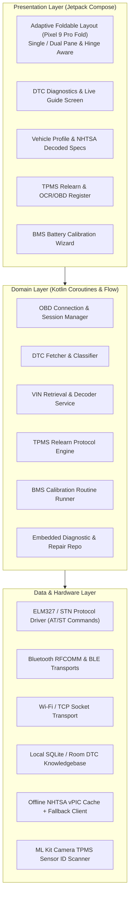

# OBD-Hero: Universal OBD2 Diagnostic & Maintenance Assistant

## Executive Overview & Mission
**OBD-Hero** is an Android application engineered for standard modern US consumer vehicles (Ford, GM, Stellantis/Chrysler, Toyota, Honda, Nissan, Hyundai, Kia, Subaru, Mazda, VW, BMW, etc.—excluding exotic supercars).

The application bridges standard SAE J1979 OBD2 protocols and manufacturer-extended diagnostics (UDS / ISO 14229) over Bluetooth / BLE / Wi-Fi ELM327 and STN-based OBD2 dongles. It provides:
1. **Full Diagnostic Trouble Code (DTC) Lifecycle**: Reading active (Mode 03), pending (Mode 07), and permanent (Mode 0A) DTCs across powertrain, body, chassis, and network modules, backed by an embedded, searchable repair guide library (symptoms, common causes, step-by-step diagnostic workflows, and verified fixes).
2. **Automated Vehicle Identification & Decode**: Instant VIN query (Mode 09 PID 02) with integrated NHTSA vPIC offline/cached decoding (Year, Make, Model, Engine, Fuel Type, Plant).
3. **TPMS Relearn & Sensor ID Registration**: ECU write workflows for TPMS sensor registration over OBD-II, coupled with a practical technical analysis of phone sensor limitations vs. dedicated RF triggers.
4. **Battery Management System (BMS) Calibration / Reset**: Guided ECU adaptation resets across major OEM platforms following a 12V battery replacement to prevent overcharging and electrical fault states.
5. **Modern, Responsive Architecture**: Native Android (Kotlin + Jetpack Compose) optimized for standard smartphones and foldables like the **Google Pixel 9 Pro Fold** (adaptive dual-pane layouts, hinge posture awareness, foldable state transitions).

---

## Technical Feasibility & Device Reality Analysis

### 1. TPMS Sensors: Phone Radios vs. Dedicated Tools vs. OBD-II Write
* **Direct RF Reading via Pixel 9 Pro Fold**:
  * Direct tire pressure monitoring sensors broadcast on ultra-high frequencies: **315 MHz** (predominantly domestic US and older Japanese makes) or **433.92 MHz** (European makes and modern universal sensors).
  * The Pixel 9 Pro Fold (and commercial smartphones in general) contains radios for Cellular (5G/LTE), Wi-Fi (2.4/5/6 GHz), Bluetooth/BLE (2.4 GHz), NFC (13.56 MHz), and UWB (6.5–8.0 GHz).
  * **Smartphone Hardware Limit**: No smartphone hardware can listen to or transmit on 315 MHz or 433 MHz RF bands without external SDR (Software-Defined Radio) or dedicated 125 kHz LF trigger hardware.
  * **Indirect TPMS vs. Direct TPMS**: Some modern vehicles (e.g., Honda, VW, Mazda) calculate tire pressure indirectly via ABS wheel speed sensor rotational variance. These require zero RF tools and can be triggered/calibrated purely via OBD2 PID / routine or dash controls.
  * **OBD-Hero Solution Architecture**:
    * **OBD2 TPMS Registration Routine**: OBD-Hero supports writing TPMS Sensor IDs into the BCM / TPMS ECU via UDS / manufacturer routine services (e.g., ISO 14229 RoutineControl `$31` or WriteDataByIdentifier `$2E`).
    * **Input Flow**:
      1. Manual hex/dec ID entry (reading printed IDs off replaced sensor shells or tire shop paperwork).
      2. Camera OCR scanner: Live optical character recognition using ML Kit Text Recognition to scan printed sensor barcodes or 8-digit hex IDs directly from the sensor casing.
      3. Bluetooth BLE TPMS support: For aftermarket direct BLE valve-stem sensors (which broadcast on standard 2.4 GHz BLE).
      4. Step-by-step OEM manual relearn instructions (e.g., ignition cycles, brake pedal sequence, hazard switch toggling, key fob pairing).

### 2. Battery Monitoring System (BMS) Calibration / Reset
* When a modern vehicle receives a new 12V battery, the alternator charging algorithm must be informed. Otherwise, the ECU continues using degraded-capacity profiles, leading to premature battery death, disabled start/stop, or electrical phantom codes.
* **Vehicle Implementation Breakdown**:
  * **Ford**: Battery Age Reset (BCM / BMS PID `$224028` / UDS Routine `$31` / ignition sequence).
  * **GM (Chevrolet, GMC, Buick, Cadillac)**: BCM state-of-charge relearn routine / sleep cycle trigger.
  * **Toyota / Lexus**: Initialization of battery sensor current integration via OBD2 or manual sequence.
  * **BMW / Mini**: Register Battery Replacement (`CBS` - Condition Based Service reset via Job/UDS).
  * **VAG (Volkswagen / Audi)**: Adaptation channel reset (entering Amp-hour rating, battery technology AGM/EFB/Wet, and serial number).
  * **Stellantis / Jeep / Ram**: IBS (Intelligent Battery Sensor) calibration calibration command.
* **OBD-Hero Strategy**: A dedicated "Battery Hero" service wizard that queries vehicle VIN, identifies the specific BMS reset protocol, verifies engine-off conditions, and executes the proprietary UDS routine or guided key sequence.

---

## Architectural Design

### Layered Architecture Diagram

---

## Core Feature Specifications

### 1. Universal DTC Diagnostic Engine & Interactive Repair Library
* **Scan Modes Supported**:
  * Standard OBD2 Mode 01: Monitor status and readiness (MIL status, misfire, EVAP, catalytic converter).
  * Mode 03: Confirmed / Stored Diagnostic Trouble Codes.
  * Mode 07: Pending DTCs (fault detected during current or last driving cycle, not yet illuminating MIL).
  * Mode 0A: Permanent DTCs (faults that cannot be cleared by scan tool until confirmed resolved by drive cycle).
  * Mode 04: Clear DTCs and reset freeze frame data (with confirmation modal and warnings).
  * Mode 02: Freeze Frame retrieval (capture engine RPM, coolant temp, speed, fuel trims at moment code tripped).
* **Enhanced DTC Coverage**:
  * Powertrain (`P0xxx`, `P1xxx`, `P2xxx`, `P3xxx`).
  * Chassis (`C0xxx`, `C1xxx` - ABS, traction control, steering angle).
  * Body (`B0xxx`, `B1xxx` - Airbags, BCM, HVAC, instrument cluster).
  * Network / Communication (`U0xxx`, `U1xxx` - CAN bus timing, lost communication between modules).
* **Built-in Repair Guide Knowledgebase (Inspired by MX-5 Dash)**:
  * Embedded SQLite database of 10,000+ SAE standard and top OEM manufacturer codes.
  * Each DTC card provides:
    * **Code & Formal SAE Title**: e.g. `P0171 - System Too Lean (Bank 1)`.
    * **Subsystem Category**: Fuel & Air Metering, Ignition, Emission Control, etc.
    * **What the ECU Detected**: Technical trigger conditions.
    * **Observable Symptoms**: Rough idle, sluggish acceleration, fuel smell, hard start.
    * **Physical Inspection Checklist**: Step 1 to Step 5 prioritized physical inspections (e.g. vacuum leaks, MAF contamination, intake boot tears).
    * **Top Verified Fixes**: Historical fix percentages (e.g. 60% MAF cleaning, 25% intake vacuum hose replacement, 15% upstream O2 sensor).
    * **Difficulty & Tool Rating**: DIY rating (Beginner/Intermediate/Advanced) and required tools (multimeter, smoke tester, 10mm socket).

### 2. Vehicle Identification & VIN Retrieval Engine
* **Protocol Retrieval**: Mode 09 PID 02 query sends request across functional address `7DF` or physical addresses `7E0-7E7`.
* **Multi-frame Assembly**: ISO 15765-2 transport protocol reassembly for 17-character VIN string across CAN frames.
* **VIN Decoding**:
  * Built-in checksum validation (Character 9 check-digit algorithm).
  * Offline NHTSA vPIC database cache bundled with app for instant Year, Make, Model, Trim, Engine size, Fuel type, and Drive type identification without requiring active cellular connection in a garage.
  * Automatic vehicle profile creation with service log history.

### 3. TPMS Diagnostics & Relearn / Registration System
* **Vehicle Protocol Mapping**:
  * UDS OBD2 Write: Direct OBD2 writing of sensor hex IDs into BCM (common on Toyota/Lexus via CAN 750/758, Nissan/Infiniti, Honda, Hyundai/Kia).
  * OBD2 Relearn Mode Trigger: Commanding ECU into "Learn" mode over OBD2, allowing manual pressure deflation sequence to register wheels (e.g., GM, Ford).
* **Smart Input Assist**:
  * ML Kit OCR Scanner: Point phone camera at new sensor stem or packaging to automatically parse 8-digit hexadecimal / 10-digit decimal sensor IDs.
  * Wheel-by-Wheel Visual Interface: Visual vehicle tire diagram (Front-Left, Front-Right, Rear-Right, Rear-Left, Spare) showing target pressures and active ID mappings.
* **Relearn Procedure Handbook**: Comprehensive offline vehicle-specific manual relearn procedures (e.g. "Key ON, press hazard button 3 times, honk horn will confirm learn mode").

### 4. Battery Calibration / BMS Reset Tool ("Battery Hero")
* **Purpose**: Clear historical battery age and charge decay models in the BCM/PCM so the smart alternator applies the proper charging voltage (bulk/absorb/float) for a fresh battery.
* **OEM Implementations Supported**:
  * **Ford BMS Reset**: Mode 22 / UDS Routine `$31` execution or automated guided flash-to-pass / brake sequence generator.
  * **GM BCM Reset**: Battery Current Sensor adaptation reset via diagnostic command.
  * **Toyota / Lexus**: Smart Key / Current Sensor memory clear.
  * **VAG Group (VW / Audi)**: Adaptation 19 (Gateway) battery parameter coding (Capacity Ah, Brand, Serial Number, AGM vs EFB).
  * **BMW / Mini**: CBS Battery Registration trigger (resets mileage at replacement and resets charge histograms).
* **Safety Guardrails**:
  * Engine RPM verification (must be 0 RPM / Key-ON Engine-OFF).
  * Battery voltage check prior to routine execution (must be >= 11.9V to avoid bricking modules).
  * Pre-and-post status verification readback.

---

## Pixel 9 Pro Fold & Hardware Optimization

1. **Foldable Responsive Form Factors**:
   * **Folded (Cover Screen - 20:9)**: Streamlined single-column handheld diagnostic scanner; fast DTC quick-scan, large tap targets for gloved or oily hands.
   * **Unfolded (Inner Main Screen - ~1:1 Large Canvas)**: Dual-pane master-detail diagnostic suite:
     * *Left pane*: ECU module tree, live status, DTC fault list.
     * *Right pane*: Full detailed repair manual, wiring clues, inspection checklist, freeze frame graphs.
   * **Tabletop / Half-Fold Posture**: Place the phone upright on the engine bay cowl or dashboard while testing hands-free. Upper screen shows live PID telemetry / relearn status, lower screen shows control buttons.
2. **Connectivity Support**:
   * Bluetooth Classic (RFCOMM / SPP) for ELM327 / OBDLink LX.
   * Bluetooth Low Energy (BLE) for modern BLE OBD adapters (vLinker MC+, Veepeak OBDCheck BLE+, Carista).
   * Wi-Fi (TCP socket 192.168.0.10:35000) for standard Wi-Fi dongles.

---

## Detailed Step-by-Step Implementation Roadmap

### Phase 1: Foundation & OBD Communication Layer
- [ ] Initialize Android Kotlin project in `OBD-Hero` with Jetpack Compose, Material 3, and Coroutines/Flow.
- [ ] Implement ELM327 / STN communication abstraction (`ElmConnection`, AT command state machine: `ATZ`, `ATE0`, `ATL0`, `ATSP0`, `ATH1`).
- [ ] Build transport drivers: Bluetooth Classic RFCOMM, BLE GATT, and Wi-Fi TCP Sockets.
- [ ] Implement auto-protocol detection and bus keep-alive worker.

### Phase 2: Diagnostic Core (DTCs & Repair Guide)
- [ ] Implement SAE J1979 Mode 01 (Live Readiness), Mode 03 (Stored), Mode 07 (Pending), Mode 0A (Permanent), Mode 04 (Clear).
- [ ] Implement multi-ECU response handling (Engine `7E8`, Transmission `7E9`, ABS/BCM).
- [ ] Create embedded Room/SQLite DTC database incorporating SAE definitions + rich actionable repair guides (symptoms, inspections, fixes).
- [ ] Build Freeze Frame (Mode 02) parser.

### Phase 3: Vehicle Profile & Offline VIN Decryption
- [ ] Implement Mode 09 PID 02 ISO-TP multi-frame parser to extract 17-character VIN.
- [ ] Implement offline VIN decoder (NHTSA vPIC cached dataset + checksum validator).
- [ ] Build Vehicle Profile UI with maintenance tracking and historical scan archives.

### Phase 4: BMS Battery Calibration System
- [ ] Research and implement OEM BMS reset command templates (Ford, GM, Toyota, VAG, BMW, Stellantis).
- [ ] Implement safety check engine (KOEO validation, voltage sanity check).
- [ ] Create step-by-step interactive reset wizard with post-reset verification.

### Phase 5: TPMS Management & ML Kit OCR
- [ ] Implement TPMS sensor ID OCR reader using Google ML Kit Camera Text Recognition.
- [ ] Build visual tire layout selector (FL, FR, RR, RL, Spare).
- [ ] Implement OBD2 TPMS ID write routines for supported manufacturers (Toyota, Nissan, Honda, Hyundai/Kia).
- [ ] Assemble comprehensive database of manual/ignition-based TPMS relearn procedures for vehicles without OBD write.

### Phase 6: Foldable UI & Polishing (Pixel 9 Pro Fold)
- [ ] Implement Jetpack WindowManager adaptive layouts (`ListDetailPaneScaffold`).
- [ ] Support Tabletop posture UI for engine bay and dashboard use.
- [ ] Implement telemetry simulation mode (virtual ECU) for rapid testing without vehicle connection.
- [ ] Full end-to-end testing, error handling, and release readiness.

---

## Hardware Adapter Compatibility Matrix

| Adapter Family | Connection Type | Protocol Support | Speed & Reliability | Recommendation Tier |
|---|---|---|---|---|
| **OBDLink LX / MX+** | BT Classic / BLE / STN | Full SAE + SW-CAN + MS-CAN | Ultra-Fast / Highest | ⭐⭐⭐⭐⭐ Primary Target |
| **vLinker MC+ / FD+** | BT 4.0 / BLE / STN | Full SAE + SW-CAN + MS-CAN | High Speed / Rock Solid | ⭐⭐⭐⭐⭐ Recommended |
| **Veepeak OBDCheck BLE+** | BLE (CC2541) | Standard 11-bit / 29-bit CAN | Moderate / Reliable | ⭐⭐⭐⭐ Recommended Consumer |
| **Generic ELM327 v1.5** | BT Classic / Wi-Fi | Standard CAN (ISO 15765-4) | Variable / Basic | ⭐⭐⭐ Supported Basic |
| **Generic ELM327 v2.1** | BT Classic | Often buggy clones | Poor / High Packet Drop | ⚠️ Warn User |
