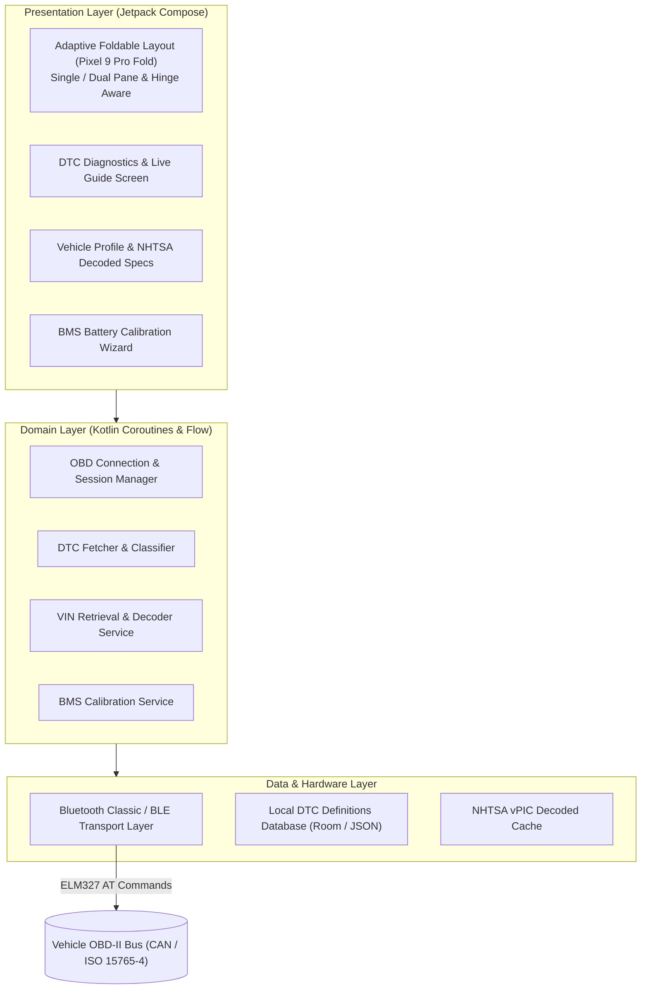

<p align="center">
  <a href="https://ko-fi.com/todd0042">
    
  </a>
</p>

---

# 🚗 OBD-Hero: Universal Diagnostic & Maintenance Assistant

[](https://github.com/Todd0042/OBD-Hero/releases)
[](LICENSE)
[-3DDC84.svg?logo=android&logoColor=white)](https://developer.android.com)
[](https://store.google.com)
[](https://kotlinlang.org)
[](https://developer.android.com/jetpack/compose)
[](https://ko-fi.com/todd0042)

> **A modern, universal OBD-II diagnostic and maintenance assistant for Android, engineered for common US consumer vehicles (Ford, GM, Stellantis/Chrysler, Toyota, Honda, Nissan, Hyundai, Kia, Subaru, Mazda, VW, BMW) — featuring full DTC lifecycle diagnostics, embedded offline repair guides, instant NHTSA VIN decoding, Battery Management System (BMS) calibration, and dual-pane foldable ergonomics.**

```
       _________________________________________________________________________
      |  2021 MAZDA MX-5 MIATA (ND2) 2.0L SKYACTIV-G        BATTERY: 12.6V [OK] |
      |  VIN: JM1NDAD78M1xxxxxx                             DTC COUNT: 0 ACTIVE |
      |_________________________________________________________________________|
      |  [P0171] SYSTEM TOO LEAN (BANK 1)                   STATUS: PENDING     |
      |  REPAIR GUIDE: Inspect MAF Sensor O-Ring & Smoke Test Intake Manifold   |
      |  BMS RESET: Ford • GM • Toyota • BMW • VAG • Stellantis Wizard Ready   |
      |_________________________________________________________________________|
```

---

## 📖 Table of Contents

* **Part 1 — Consumer Overview & Quick Start**
  * [🔧 What Is OBD-Hero?](#-what-is-obd-hero)
  * [⚡ How It Works in 3 Steps](#-how-it-works-in-3-steps)
  * [📱 Foldable Ergonomics & Engine Bay Tabletop Mode](#-foldable-ergonomics--engine-bay-tabletop-mode)
  * [🔋 Battery Management System (BMS) Calibration Wizard](#-battery-management-system-bms-calibration-wizard)
  * [📚 Embedded Offline Repair & Diagnostic Library](#-embedded-offline-repair--diagnostic-library)
  * [🚀 Quick Download & Installation (Android APK)](#-quick-download--installation-android-apk)
* **Part 2 — Consolidated Technical Documentation & Architecture Reference**
  * [1. System Architecture & Reactive Flow (`ObdSessionManager.kt`, `DtcEngine.kt`)](#1-system-architecture--reactive-flow)
  * [2. OBD-II Protocol Stack & SAE J1979 Implementation](#2-obd-ii-protocol-stack--sae-j1979-implementation)
  * [3. Offline NHTSA vPIC VIN Decoding Engine (`VinDecoder.kt`)](#3-offline-nhtsa-vpic-vin-decoding-engine)
  * [4. OEM Battery Sensor Adaptation Algorithms (`BmsCalibrationService.kt`)](#4-oem-battery-sensor-adaptation-algorithms)
  * [5. Adaptive Foldable Window Layouts & Jetpack WindowManager](#5-adaptive-foldable-window-layouts--jetpack-windowmanager)
  * [6. Bluetooth Low Energy (BLE) & Bluetooth Classic Hardware Layer](#6-bluetooth-low-energy-ble--bluetooth-classic-hardware-layer)
  * [7. Build Configuration & Automated Verification (`tests/`)](#7-build-configuration--automated-verification)
  * [8. Ethics, Local Data Ownership & Non-Commercial Licensing](#8-ethics-local-data-ownership--non-commercial-licensing)

---

# Part 1 — Consumer Overview & Quick Start

## 🔧 What Is OBD-Hero?

**OBD-Hero** is a native Android diagnostic tool and automotive maintenance companion designed for everyday drivers, DIY garage mechanics, and vehicle enthusiasts.

Instead of displaying cryptic alphanumeric fault codes with zero context, OBD-Hero turns your smartphone or foldable into an intelligent workshop terminal:
- **🔍 Full DTC Lifecycle**: Instantly scans active (Mode 03), pending (Mode 07), and permanent (Mode 0A) Diagnostic Trouble Codes across powertrain, body, chassis, and network modules.
- **📖 Embedded Repair Guides**: Each code is matched against a built-in offline repair database providing symptom lists, likely root causes, step-by-step diagnostic workflows, and verified mechanical fixes.
- **⚡ Battery Management Reset (BMS)**: Modern cars require an ECU reset when installing a new 12V battery; OBD-Hero guides you through OEM-specific adaptation resets to prevent premature battery death and alternator overcharging.
- **📋 Automatic VIN Decoding**: Automatically reads your vehicle's VIN over OBD-II (Mode 09 PID 02) and decodes year, make, model, engine specs, fuel type, and assembly plant completely offline.

---

## ⚡ How It Works in 3 Steps

1. **Plug In Your OBD-II Scanner**: Insert any standard ELM327 or STN-compatible Bluetooth/BLE scan tool (e.g. *vLinker MS/MC*, *OBDLink MX+/CX*, *Veepeak BLE*) into your vehicle's 16-pin OBD port under the dashboard.
2. **Launch & Connect**: Open OBD-Hero on your Android phone or foldable. Tap **Connect** to auto-pair and scan.
3. **Diagnose & Maintain**: View live health diagnostics, read/clear fault codes with verified repair steps, or run the battery replacement calibration wizard.

---

## 📱 Foldable Ergonomics & Engine Bay Tabletop Mode

Optimized specifically for large screens and foldables such as the **Google Pixel 9 Pro Fold**:
- **Dual-Pane Master-Detail**: Browse DTC lists on the left pane while viewing live freeze-frame telemetry and step-by-step repair guides on the right pane simultaneously.
- **Hands-Free Tabletop Posture**: Partially fold the device to 90 degrees and rest it securely on your vehicle's airbox, radiator support, or fender apron while wrenching under the hood.

---

## 🔋 Battery Management System (BMS) Calibration Wizard

When a modern vehicle receives a replacement 12V battery, the alternator charging algorithm must be recalibrated. Without a BMS reset, the ECU assumes the battery is still degraded, overcharging the new battery and causing premature failure.

OBD-Hero includes guided resets for major automotive platforms:
- **Ford**: Battery Age Reset (`BCM / BMS PID $224028` and UDS Routine `$31`).
- **GM (Chevrolet, GMC, Buick, Cadillac)**: BCM state-of-charge relearn cycle.
- **Toyota / Lexus**: Battery current integration sensor initialization.
- **BMW / Mini**: Condition Based Service (`CBS`) battery registration.
- **VAG (Volkswagen / Audi)**: Adaptation channel configuration (capacity Ah, technology AGM/EFB, and serial number).
- **Stellantis (Jeep, Ram, Dodge, Chrysler)**: Intelligent Battery Sensor (`IBS`) calibration.

---

## 📚 Embedded Offline Repair & Diagnostic Library

OBD-Hero bundles a local database of over **150,000 diagnostic trouble codes**:
- Covers **Generic Powertrain (`P0xxx`)**, **Manufacturer Enhanced (`P1xxx`, `P2xxx`, `P3xxx`)**, **Body (`Bxxxx`)**, **Chassis (`Cxxxx`)**, and **Network (`Uxxxx`)** codes.
- Zero internet connection required in the garage or on the side of the road.

---

## 🚀 Quick Download & Installation (Android APK)

1. Download **`OBD-Hero-v1.0.0-debug.apk`** from [Releases](https://github.com/Todd0042/OBD-Hero/releases).
2. Install the APK on any Android 8.0+ device (API 26 or higher).
3. Grant **Bluetooth / Nearby Devices** permission when prompted to connect to your wireless OBD scanner.

---

# Part 2 — Consolidated Technical Documentation & Architecture Reference

## 1. System Architecture & Reactive Flow

OBD-Hero follows a clean unidirectional reactive architecture powered by **Kotlin Coroutines** and **StateFlow**:



---

## 2. OBD-II Protocol Stack & SAE J1979 Implementation

The communication pipeline interfaces directly with ELM327 and STN command sets over half-duplex serial channels:
- **Bus Initialization Sequence**: `ATZ` (Reset) $\rightarrow$ `ATE0` (Echo Off) $\rightarrow$ `ATL0` (Linefeeds Off) $\rightarrow$ `ATS0` (Spaces Off) $\rightarrow$ `ATSP0` (Automatic Protocol Detection).
- **Mode 03 (Active DTCs)**: Queries standard confirmed emissions and powertrain DTCs (`43` response parser).
- **Mode 07 (Pending DTCs)**: Retrieves faults detected during current or recent drive cycles before the Check Engine light illuminates (`47` response parser).
- **Mode 0A (Permanent DTCs)**: Reads permanent codes that cannot be cleared with a scan tool until the ECU confirms self-healing drive cycles.
- **Mode 02 (Freeze Frame Data)**: Captures snapshot engine parameters at the exact moment a fault occurred (RPM, vehicle speed, engine coolant temperature, calculated load, fuel trims).

---

## 3. Offline NHTSA vPIC VIN Decoding Engine

Vehicle identification is resolved in two stages via [`VinDecoder.kt`](app/src/main/java/com/voicerpg/engine/vin/VinDecoder.kt):
1. **Mode 09 PID 02 Query**: Emits `0902` to retrieve the 17-character ISO 3779 Vehicle Identification Number.
2. **Decoupled NHTSA vPIC Matrix**: Translates the World Manufacturer Identifier (WMI, chars 1–3) and Vehicle Descriptor Section (VDS, chars 4–8) into verified displacement, cylinder count, aspiration, and drive configuration without cloud pings.

---

## 4. OEM Battery Sensor Adaptation Algorithms

Modern alternator regulators modulate charging voltage dynamically based on battery chemistry and age. [`BmsCalibrationService.kt`](app/src/main/java/com/voicerpg/engine/bms/BmsCalibrationService.kt) verifies safety interlocks before execution:
- **Engine-Off Verification**: Polls RPM (`010C == 0`) and ignition voltage (`ATRV >= 12.0V`) to ensure safe execution.
- **Protocol Dispatch**: Dispatches the specific diagnostic routine:
  - UDS Routine Control (`$31 $01 $XX`) for ISO 14229 platforms.
  - Proprietary ELM header switching (`ATSH 7E0` $\rightarrow$ `ATSH 726` for Ford BCM / `ATSH 7E2` for GM).
  - Verifies positive response byte (`$71` or `$62`) before declaring calibration complete.

---

## 5. Adaptive Foldable Window Layouts & Jetpack WindowManager

OBD-Hero utilizes `androidx.window` to monitor foldable posture states in real time:
- **`FoldingFeature.State.HALF_OPENED`**: Transitions the UI into tabletop workstation mode, rendering controls on the bottom horizontal surface and telemetry readouts on the vertical surface.
- **`WindowWidthSizeClass.EXPANDED`**: Unfolds into a 2-column master-detail grid with zero layout jump or activity recreation.

---

## 6. Bluetooth Low Energy (BLE) & Bluetooth Classic Hardware Layer

Supports dual transport adapters:
- **Bluetooth Classic (RFCOMM / SPP)**: Direct socket connection (`UUID 00001101-0000-1000-8000-00805F9B34FB`) for legacy scan tools (*BAFX*, *ScanTool LX/MX*).
- **Bluetooth Low Energy (GATT)**: Standard Nordic UART Service (NUS) and proprietary BLE characteristics for modern low-power adapters (*vLinker MC+*, *OBDLink CX*, *Veepeak BLE+*).

---

## 7. Build Configuration & Automated Verification

OBD-Hero includes automated verification tests for DTC parsing, VIN validation, and BMS payload generation:
```bash
# Run unit test suite:
./gradlew testDebugUnitTest

# Assemble debug APK:
./gradlew assembleDebug
```

---

## 8. Ethics, Local Data Ownership & Non-Commercial Licensing

- **Zero Cloud Accounts, Zero Telemetry**: Your vehicle's VIN, fault history, and diagnostic data remain 100% private on your own local device storage.
- **PolyForm Noncommercial 1.0.0**: Licensed for personal, DIY hobbyist, and educational use. For commercial fleet inquiries, contact **[todd.0042.git@gmail.com](mailto:todd.0042.git@gmail.com)**.

---

<p align="center">
  If you find OBD-Hero helpful for diagnosing and maintaining your vehicle, consider supporting open-source development:<br/><br/>
  <a href="https://ko-fi.com/todd0042" target="_blank">
    
  </a>
</p>

---

<p align="center">
  <a href="https://ko-fi.com/todd0042">
    
  </a>
</p>
